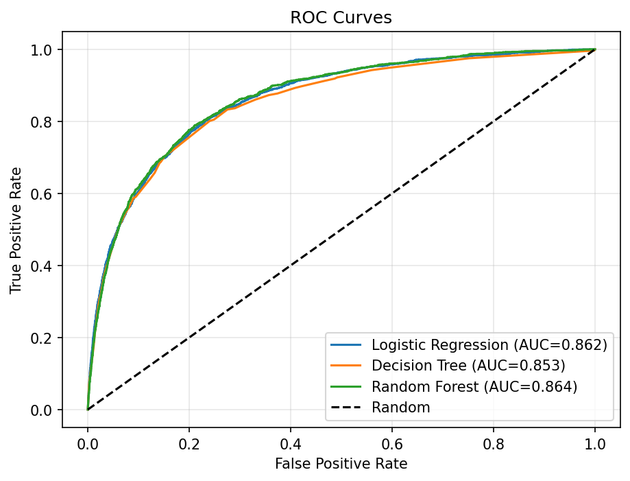
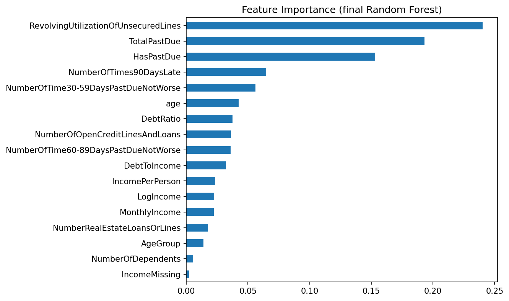
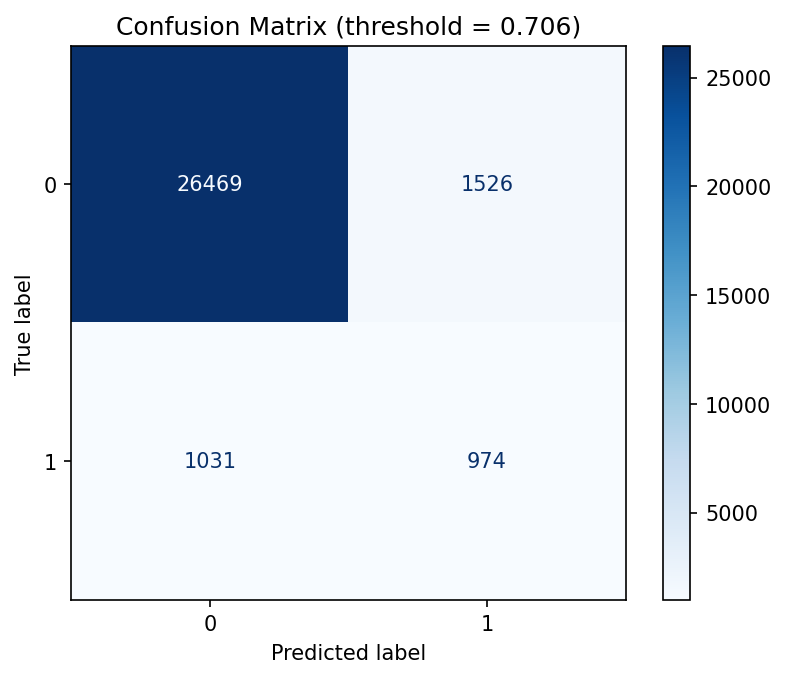
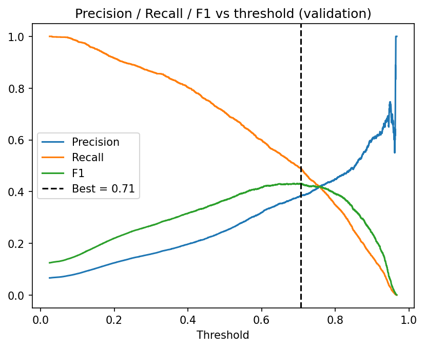

# Credit Scoring Model

An educational credit-scoring project that estimates a client's probability of default within two years. It includes a trained Random Forest model, a FastAPI service, a React/Vite dashboard, and a Streamlit alternative.

## Objective

Estimate the probability that a client will experience serious delinquency or default within two years, using the Give Me Some Credit data.

## Dataset

The project uses the [Give Me Some Credit dataset on Kaggle](https://www.kaggle.com/c/GiveMeSomeCredit/data). The dataset is not included in this repository.

1. Download `cs-training.csv` from Kaggle.
2. Place it at `datasets/GiveMeSomeCredit/cs-training.csv`.
3. Keep the downloaded data local. The `datasets/` directory is excluded from Git.

The committed trained model and preprocessing parameters are sufficient to run the prediction applications; the training dataset is needed only to reproduce model training and analysis.

## Methodology

- **Cleaning:** remove invalid ages, interpret the special delinquency codes `96` and `98`, handle missing values, and clip outliers at the 99th percentile.
- **Feature engineering:** add `TotalPastDue`, `HasPastDue`, `IncomePerPerson`, `DebtToIncome`, `LogIncome`, and `AgeGroup`.
- **Class imbalance:** defaults account for about 6.7% of observations; models use `class_weight='balanced'`.
- **Evaluation:** split the data into 60% training, 20% validation, and 20% test sets. Select the classification threshold on the validation set using F1, then report final metrics on the held-out test set.
- **Models compared:** Logistic Regression, Decision Tree, and Random Forest.

## Results

### Model comparison

Values below are from [`results/models_comparison.csv`](results/models_comparison.csv).

| Model | Precision | Recall | F1 | ROC-AUC |
|---|---:|---:|---:|---:|
| Logistic Regression | 0.216 | 0.764 | 0.337 | 0.862 |
| Decision Tree | 0.188 | 0.805 | 0.305 | 0.853 |
| Random Forest | 0.243 | 0.712 | 0.362 | 0.864 |

### Final Random Forest test-set metrics

Values below are from [`results/final_metrics.json`](results/final_metrics.json). The decision threshold was selected on the validation set.

| Threshold | Precision | Recall | F1 | ROC-AUC |
|---:|---:|---:|---:|---:|
| 0.706 | 0.390 | 0.486 | 0.432 | 0.862 |

The comparison table and final metrics are reported separately because the final metrics use the selected decision threshold.

### Performance charts

#### ROC curves



#### Feature importance



#### Confusion matrix



#### Threshold selection



## Project structure

```text
CreditScoringModel/
├── api.py
├── app.py                         # Streamlit alternative
├── credit_scorer.py
├── models/
│   ├── preprocessing_params.json
│   └── random_forest_final.joblib
├── results/
│   ├── final_metrics.json
│   ├── models_comparison.csv
│   └── *.png
├── frontend/
│   ├── package.json
│   └── src/
├── docs/
│   └── screenshots/
├── requirements.txt
└── test_scorer.py
```

The `datasets/`, `.venv/`, `frontend/node_modules/`, and frontend build output are not committed.

## Installation and usage

### Requirements

- Python 3.10 or later
- Node.js and npm (for the React/Vite frontend)
- Windows PowerShell

### Set up Python

From the project root:

```powershell
py -m venv .venv
.\.venv\Scripts\Activate.ps1
python -m pip install --upgrade pip
pip install -r requirements.txt
```

### Run the FastAPI backend

In the project root, with the virtual environment activated:

```powershell
uvicorn api:app --reload --port 8000
```

The API is available at `http://localhost:8000`; interactive API documentation is at `http://localhost:8000/docs`.

### Run the React/Vite frontend

In a second PowerShell terminal:

```powershell
Set-Location .\frontend
npm install
npm run dev
```

Open `http://localhost:5173`. The Vite development server proxies API and results requests to the backend on port 8000, so keep the backend running.

### Run the Streamlit alternative

In a PowerShell terminal at the project root, with the Python virtual environment activated:

```powershell
streamlit run app.py
```

### Run the scorer smoke test

With the Python environment activated, run:

```powershell
python test_scorer.py
```

## Interface screenshots

Add interface screenshots to [`docs/screenshots/`](docs/screenshots/) and embed them here. The folder is included in the repository with a placeholder file.

## Limitations and future improvements

- The dataset is imbalanced, which makes the precision/recall trade-off important.
- Monthly income is missing for about 20% of observations and is median-imputed.
- The decision threshold is selected using F1 only; it does not incorporate the different real-world costs of false approvals and false rejections.
- XGBoost was not included in the model comparison.
- Potential improvements include comparing XGBoost or LightGBM, adding SHAP explanations, and selecting a cost-sensitive decision threshold.

## Disclaimer

This is an educational project. Its estimates are not financial advice and must not be used to approve, deny, price, or otherwise make real credit decisions.
